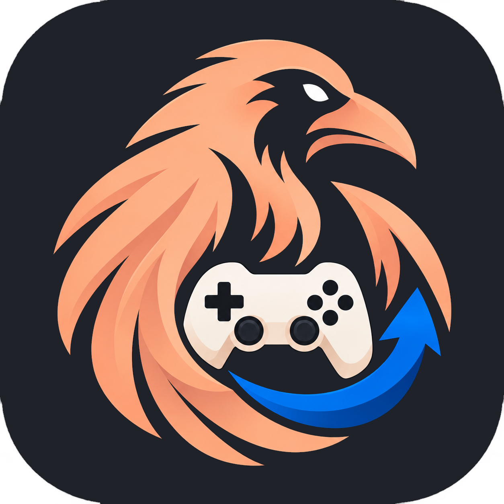

# Raven Gamepad

Use your handheld's built-in controls as a virtual DualShock 4 in selected Android apps. One APK includes app selection, controller mapping, diagnostics and the bridge components.

**Current final release: 0.16.1 (version code 33).** Previously named DS4 Bridge; the package and signing identity remain unchanged, so the official APK can update an existing installation.

[Download Raven Gamepad](https://github.com/Rsotbiemrptson/Raven-Gamepad/releases/download/v0.16.1/Raven-Gamepad-0.16.1.apk) · [Release notes](https://github.com/Rsotbiemrptson/Raven-Gamepad/releases/tag/v0.16.1)

## What it does

- Forward the built-in controller to selected installed apps; search by app name or package ID and optionally show system apps.
- Handle Odin and Xbox controller modes with the correct physical face-button positions.
- Learn button mappings, record/invert axes, and apply saved mappings with a bridge restart.
- Show live physical-controller buttons, sticks and triggers, with technical checks kept separate.
- Start the bridge after reboot and the first unlock when enabled.
- Use a persistent Raven sidebar, light/dark/system themes, a color wheel, RGB sliders, hex input and Raven-family color presets.
- Open Settings and About from the three-dot menu. Settings reveals Appearance, Bridge controls, Controller mapping and Diagnostics beneath Apps; selecting Apps hides those extra tabs. Advanced component actions are collapsed by default.

## Supported scope

**Odin 2 is hardware-tested. Odin 3 and Retroid still require hardware testing.**

The standalone bridge was tested on Odin 2 stock 1.0.0.318 / Android 13 and a stock-318-based custom build. For this milestone, Remote Play buttons, D-pad, both sticks and triggers worked in-game before and after reboot; automatic bridge startup after first unlock was observed without opening Raven Gamepad.

Known Odin 2 and inspected Odin 3 Touch Mapping interfaces are detected automatically. The Odin 3 adapter is not hardware-validated. The inspected Retroid Pocket 6 integration has read-only diagnostics only: component setup, bridge startup and exclusion changes remain disabled. Unknown mapping versions are reported rather than sent guessed commands. See [Compatibility](docs/USAGE.md#compatibility).

This is **not an ordinary unprivileged APK**. On the tested Odin 2, AYN's `PServerBinder` service provides permitted root execution, Linux input access and `/dev/uinput`; no Magisk installation or firmware flash was required. A similarly named Run as root option or the same processor on another device does not establish compatibility. Android API 26 is the declared minimum, not a claim that every Android 8+ device works.

The bridge does not change firmware, device fingerprints or Play Integrity, and it cannot guarantee that another app accepts a virtual controller. It is not affiliated with AYN, Sony or PlayStation.

## Install, use and remove

- [Install and update](docs/INSTALL.md)
- [Usage, mapping, appearance and troubleshooting](docs/USAGE.md)
- [Complete removal](docs/UNINSTALL.md) — remove bridge components **before** uninstalling the APK.
- [Testing and hardware limits](docs/TESTING.md)

Automatic startup waits for the first unlock after reboot. App selection gates input forwarding; the virtual controller stays registered while the bridge is running. Battery impact has not been quantified.

## Source and building

The app uses Java and Android framework APIs plus a small native C bridge, without Gradle dependencies. [Build instructions](docs/BUILD.md) cover Windows PowerShell, JDK, Android SDK/NDK and signing. SDK tools and private signing keys are not included.

- `src/`, `res/`, `AndroidManifest.xml`: app source, resources and declarations.
- `native/`: native controller reader and virtual gamepad.
- `runtime/`: privileged launcher, supervisor and stop scripts.
- `build.ps1`: portable signed-APK build; `scripts/`: final-APK publishing helper.
- `tests/`: host checks, native tests and Android instrumentation source.
- `releases/v0.16.1/`: current signed APK and SHA-256 checksum.
- `docs/`: install, removal, usage, build, architecture and validation notes.

See [Architecture](docs/ARCHITECTURE.md) and [Release status](RELEASE-STATUS.md). Source corresponding to the official APK is available at the `v0.16.1` tag.

## License and contributions

Copyright (C) 2026 Raven Gamepad contributors. Original app source, scripts and project artwork are licensed under **GNU GPL version 3 only**; see [LICENSE](LICENSE). Distributed modified builds must comply with the GPL and provide corresponding source; private modifications do not have to be published.

See [CONTRIBUTING.md](CONTRIBUTING.md), [SECURITY.md](SECURITY.md), [CHANGELOG.md](CHANGELOG.md) and [THIRD_PARTY_NOTICES.md](THIRD_PARTY_NOTICES.md).
